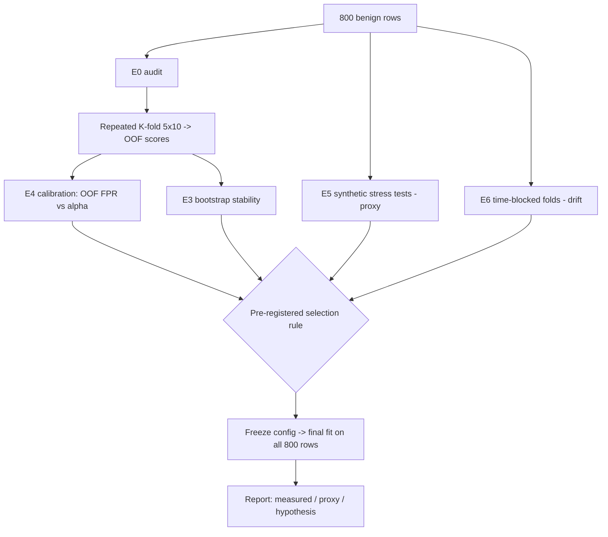

# EXPERIMENT_PLAN — Baselines, Experiments, Metrics, Validation Strategy

No experiment has been run. All tables below describe **planned** work. Notation: OOF = out-of-fold; IDs from TRD/TECHNICAL_DESIGN.

---

## 1. Principles
1. **Pre-registration.** Selection rules (§8) are fixed before E1–E7 results are viewed.
2. **Three evidence classes**, always labelled in outputs: `measured_benign` (real data, benign side), `synthetic_proxy` (perturbed benign), `hypothesis`.
3. **Resampling, not single splits**, with variability reported (mean ± sd over repeats; percentile intervals).
4. **Nothing tuned on the private set** (unavailable anyway); nothing on synthetic AUROC alone (R-06).

## 2. Validation design (no anomaly labels)

- **K-fold:** 5 folds × 10 repeats (different seeds). Each row gets 10 OOF scores → mean/median per row plus per-repeat distribution.
- **Time-blocked:** train on first 60–80% of rows, score remaining blocks (only meaningful if row order reflects collection order — check in E0).
- **Leakage guards:** preprocessing and normaliser CDFs fitted inside folds; calibration uses only OOF scores.

## 3. Metrics
| Metric | Definition | Where measurable |
|--------|-----------|------------------|
| AUROC | rank separability of anomaly vs benign scores | synthetic proxy only; real: private set |
| TPR (recall) | TP/(TP+FN) | proxy only |
| FPR | FP/(FP+TN) | **real benign OOF** and proxy |
| Accuracy | (TP+TN)/N, prevalence-dependent | proxy with stated prevalence grid |
| F1 | 2PR/(P+R), prevalence-dependent | proxy with prevalence grid |
| TPR@FPR=1%/5% | power at fixed false alarm | proxy |
| Calibration error | |OOF FPR − α| and bootstrap CI | real benign |
| Stability | Spearman ρ of OOF scores across repeats / bootstraps | real benign |
| Threshold dispersion | bootstrap CI of τ | real benign |
Prevalence grid for Accuracy/F1 reporting: p ∈ {0.1, 0.3, 0.5} (reported as scenarios; true p unknown, A5).

## 4. Baselines
| ID | Baseline | Purpose |
|----|----------|---------|
| B0 | **Trivial**: max |robust z| over features | Floor; marginal-only |
| B1 | Per-feature quantile rule (ECOD/COPOD-style) | Marginal tail aggregation |
| B2 | Shrinkage Mahalanobis (LW/OAS) | Strong parametric (H5) |
| B3 | Robust Mahalanobis (MCD) | Contamination-robust |
| B4 | PCA recon + T² | Joint structure |
| B5 | Isolation Forest | Non-parametric |
| B6 | kNN / LOF | Density |
| B7 | GMM (k by BIC; full/tied/diag/shrunk) | AdvHunter-motivated |
| B8 | One-class SVM | Boundary |
| B9 | Autoencoder (only if B1–B8 show a structural gap) | H6 check |
| B10 | Random scorer | Sanity for the synthetic test harness (expect AUROC ≈ 0.5 on proxy) |
Baselines B2–B8 are run on identical preprocessed inputs.

## 5. Experiments
| ID | Name | Question | Procedure | Output |
|----|------|----------|-----------|--------|
| E0 | Data audit | What does the data look like? (A1–A3, d, skew, correlation, drift, duplicates) | Audit module | Audit report; confirms/refutes assumptions |
| E1 | Baseline sweep | How do candidates differ on OOF score structure and stability? | B0–B10 × default hyperparameters × 5×10 CV | OOF score store, stability, runtime |
| E2 | Preprocessing ablation | Which transform/scaler is best (OD-4)? | {none, log1p, Yeo-Johnson, quantile} × {standard, robust} × top detectors | Stability, calibration, proxy power |
| E3 | Stability | Are rankings reproducible? | 200 bootstraps; Spearman of scores; τ CI | Stability table |
| E4 | Calibration | Does OOF-quantile τ(α) give FPR ≈ α? | For α ∈ {0.01, 0.05, 0.10}: nested — τ from calibration folds, FPR on disjoint test folds | |FPR−α| ± CI |
| E5 | Synthetic stress tests (**proxy**) | Which detectors are sensitive to which anomaly shapes? | Perturb held-out benign rows (below) at magnitudes m ∈ {0.5,1,2,3,5}σ-equivalent; measure AUROC/TPR@FPR | Sensitivity profiles; flagged `synthetic_proxy` |
| E6 | Drift/order | Does row order matter (OD-7)? | Time-blocked CV; autocorrelation | Drift verdict |
| E7 | Ensemble/fusion | Does fusion help (OD-1, OD-3)? | Pairwise diversity; mean vs max vs rank-mean; leave-one-detector-out | Ablation table |
| E8 | Contamination robustness | What if a few benign rows are outliers/mislabelled? | Inject synthetic outliers into training (proxy) at 1–5%; compare classic vs robust fits | Robustness curve |
| E9 | Reproducibility | Same artifact twice? | Double clean run; compare hashes | Pass/fail |
| E10 | Efficiency | Meets NFR-02? | Timing scripts | Latency table |

### E5 perturbation families (all synthetic, all from benign rows)
| Family | Construction | Targets hypothesis |
|--------|-------------|--------------------|
| P1 Mean shift | shift k random counters by +mσ | marginal shifts (B0/B1 should respond) |
| P2 Two-sided shift | random signs | H4 |
| P3 Variance inflation | scale deviations from mean by factor | dispersion change |
| P4 Correlation break | permute a correlated block across rows (marginals preserved) | H1 |
| P5 Sparse spike | one counter extreme | tail detectors |
| P6 Cluster interpolation | move toward nearest benign-cluster gap | multi-modal handling |
| P7 Scale-by-ratio | multiply a ratio-related counter pair inconsistently | ratio features |
**Interpretation rule:** E5 shows *what each method can see*, not how the real backdoor behaves. A detector doing well on P1–P7 is not evidence of real backdoor detection.

## 6. Hyperparameter grids (small, logged)
Mahalanobis: {LW, OAS, MCD(support_fraction)}; PCA: k via variance 90/95/99%; IForest: n_estimators {200,500}, max_samples {256,'auto'}; kNN: k ∈ {5,10,20,40}; LOF: k same; GMM: components 1–8 × covariance types, BIC; OCSVM: ν ∈ {0.01,0.05,0.1}, γ ∈ {scale, auto}; ECOD/COPOD defaults. All results retained, not just winners.

## 7. Statistical treatment
Paired comparisons across the same resamples; report effect sizes and intervals; no significance-hunting across many comparisons; Bonferroni or simply descriptive with caveats.

## 8. Pre-registered selection rule (draft)
1. Discard candidates failing calibration (|OOF FPR − α| outside tolerance, tolerance set at 2× the sampling SE for α, i.e. ≈ 0.015 for α=0.05) or unstable (median Spearman ρ across bootstraps below a pre-set floor, e.g., 0.8 — floor to be revisited after E0 only with written justification).
2. Among survivors, require **coverage**: the final set must include ≥1 structure-aware (B2/B3/B4/B7) and ≥1 non-parametric (B5/B6) detector unless E7 shows redundancy.
3. Break remaining ties by **worst-case** (not mean) proxy sensitivity across P1–P7, then by simplicity/latency.
4. Freeze config; document deviations.

## 9. Reporting requirements
Every table/figure has: source script, config hash, evidence class tag. The PDF report contains a "What is measured vs simulated vs hypothesised" box.

## 10. Optional external validation (OD-6)
If organizers permit and hardware allows, a **self-collected** small set of clean/backdoor traces on a *different* machine could expose A4 (cross-machine shift) and sanity-check scores. Constraints: must not be used for training or selection if rules prohibit; must be documented as an independent sanity check; collection effort and legality of any trained backdoored model are the team's responsibility. **Not planned unless OD-6 resolves favourably.**

## 11. Exit criteria
E0–E4, E9 complete (MUST); E5–E8 complete (SHOULD); config frozen; report tables regenerate from scripts.
