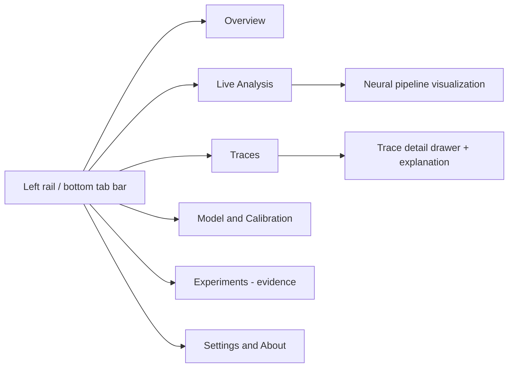
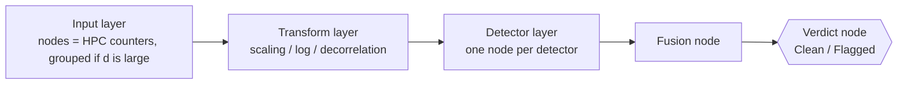

# FRONTEND_UI_UX_DESIGN — Requirements for the Companion Cybersecurity Dashboard

**Status:** Optional deliverable (not scored by the competition). Design requirements only — no implementation.
**Direction:** Premium enterprise cybersecurity SaaS · Liquid Glassmorphism · futuristic but minimal · sophisticated, not flashy.
**Governing rule:** *Every animation must communicate system activity or improve usability.* If a motion cannot name the information it carries, it is removed.
**Data integrity rule (R-17):** The dashboard renders **only** data exported by the detector (`run.json`, SRS §6.3). Absent data ⇒ explicit empty state. No demo numbers presented as results; any sample mode is badged "SAMPLE DATA — NOT A RESULT".

---

## 1. Goals and users
| Goal | Rationale |
|------|-----------|
| Make the pipeline legible (ingest → transform → detectors → fusion → verdict) | US-5 |
| Show *why* a trace was flagged | US-4, TR-Q7 |
| Communicate calibration and evidence class honestly | G4 |
| Feel premium and calm | Enterprise security context |
Users: analyst (inspects rows), presenter/judge (watches a trace flow), reviewer (checks calibration & provenance).

## 2. Information architecture

| Page | Purpose | Key modules |
|------|---------|-------------|
| **Overview** | Run summary | KPI cards (rows scored, flagged count, threshold τ, α), score distribution chart, status banner, evidence-class legend |
| **Live Analysis** | Watch scoring | Neural pipeline visualization (§6), stage progress tracker, current row card, verdict panel |
| **Traces** | Browse results | Virtualised table (sort/filter), score sparkline, label chips, detail drawer with top-k feature deviations |
| **Model & Calibration** | Trust the threshold | Benign OOF score histogram with τ marker, FPR-vs-α curve, detector contribution bars, manifest/provenance |
| **Experiments** | Evidence ledger | Tables from EXPERIMENT_PLAN with evidence-class badges (`measured`, `synthetic proxy`, `hypothesis`) |
| **Settings/About** | Preferences, reduced motion, theme, data loading | File picker for `run.json`, docs links |

## 3. Visual language — Liquid Glassmorphism, restrained
### 3.1 Depth model (4 layers)
| Layer | Role | Treatment |
|-------|------|-----------|
| L0 Canvas | Background | Deep gradient (navy → ink), very low-contrast large soft blobs; static or ≤ 0.02 Hz drift |
| L1 Surface glass | Cards, panels | `backdrop-filter: blur(16–24px) saturate(140%)`, fill rgba(white, 0.06–0.10) dark / rgba(255,255,255,.55) light, 1px inner border rgba(255,255,255,.14), soft shadow `0 8px 32px rgba(0,0,0,.28)` |
| L2 Raised glass | Drawers, popovers, modals | Higher blur, stronger border highlight, shadow `0 16px 48px` |
| L3 Focus | Active/selected | Subtle accent ring + 1 px top-edge specular highlight |
"Liquid" quality: soft specular edge highlight on the top border, gentle corner radii (16–24 px), slight gradient sheen that **responds to pointer position** on cards (≤ 4% brightness shift) — a usability cue for hover affordance, not decoration.

### 3.2 Colour tokens (CSS variables; provisional values)
| Token | Dark | Light | Use |
|-------|------|-------|-----|
| `--bg-0` | #0A0E1A | #EEF2F8 | Canvas |
| `--glass-fill` | rgba(255,255,255,.07) | rgba(255,255,255,.60) | Panels |
| `--glass-border` | rgba(255,255,255,.14) | rgba(20,30,60,.10) | Edges |
| `--text-1` | #F2F5FB | #0F1730 | Primary |
| `--text-2` | #AAB4CC | #4A5678 | Secondary |
| `--accent` | #5B8CFF | #2F5BDB | Interactive / brand |
| `--ok` | #34D399 | #0E9F6E | Clean |
| `--warn` | #F5B544 | #B7791F | Caution/uncalibrated |
| `--threat` | #FF5C7A | #D6304F | Flagged/backdoor |
| `--info-proxy` | #A78BFA | #6D4BD6 | Synthetic-proxy evidence |
Rule: **one** accent hue; semantic colours only for state; glow limited to a 0–8 px blur on the *single* active element; no neon gradients.
All text/background pairs must be computed against the **effective** glass backdrop (see §10).

### 3.3 Typography
- UI: Inter (variable) or system UI stack fallback; Data/mono: JetBrains Mono (or system mono) with tabular numerals.
- Scale (rem): 0.75 / 0.875 / 1 / 1.125 / 1.5 / 2 / 2.75; weights 400/500/600; line-height 1.4–1.6 body; letter-spacing −0.01em on large headings.
- Numerals in KPIs and tables use `font-variant-numeric: tabular-nums`.
### 3.4 Spacing, radius, elevation
4-px base grid; spacing tokens 4/8/12/16/24/32/48; radii 8/12/16/24; max 3 shadow levels. Consistent 24 px card padding (16 px on mobile).

## 4. Motion system
| Token | Duration | Easing | Use |
|-------|----------|--------|-----|
| `--t-fast` | 120 ms | cubic-bezier(.2,0,0,1) | Hover, press |
| `--t-base` | 220 ms | cubic-bezier(.2,0,0,1) | Component state change |
| `--t-slow` | 420 ms | cubic-bezier(.16,1,.3,1) | Page/drawer transitions |
| `--t-flow` | continuous | linear | Data-flow particles only |
Principles:
1. **Meaning mapping** (mandatory table — every animation listed here, none outside):

| Animation | Information conveyed |
|-----------|---------------------|
| Particle flow along edges | Data moving through a pipeline stage; speed ∝ throughput; stops when idle |
| Node pulse | Stage currently computing |
| Node settle (steady) | Stage complete |
| Edge intensity | Contribution of that detector to the final score |
| Verdict morph | Clean (green settle) vs Flagged (red pulse, 2 cycles then steady) |
| Skeleton shimmer | Loading placeholder for pending data |
| Number count-up | Value changed from previous run (≤ 400 ms; skipped if reduced motion) |
| Page transition (fade + 8 px translate) | Spatial continuity between pages |
| Drawer slide | Detail is subordinate to the table |
2. Animate only `transform` and `opacity` (plus `backdrop-filter` on state changes of overlays, never continuously).
3. `prefers-reduced-motion: reduce` ⇒ particles replaced by static arrows + stage highlight, transitions ≤ 80 ms opacity-only, count-up disabled; a visible in-app "Reduce motion" toggle overrides the OS default.
4. No looping decorative animation on non-visualization screens; background drift ≤ 0.02 Hz or static.
5. Animations pause when the tab is hidden or the element is off-screen.

## 5. Component library and states
### 5.1 Buttons (primary / secondary / ghost / danger-confirm)
| State | Treatment | Notes |
|-------|-----------|-------|
| Default | Glass or solid accent | Min target 44×44 px |
| Hover | +4% brightness, 1 px lift (`translateY(-1px)`), pointer-sheen | `--t-fast` |
| Focus-visible | 2 px accent ring + 2 px offset, never removed | Keyboard-first |
| Active | Scale .98, shadow reduces | Immediate feedback |
| Loading | Label stays, spinner replaces icon, width locked, `aria-busy=true`, click disabled | No layout shift |
| Disabled | 45% opacity, no pointer events, `aria-disabled`, tooltip explaining *why* | Not colour-only |
| Success | Check icon morph + green ring 1.2 s then revert; announced via `aria-live=polite` | |
| Error | Shake ≤ 2 cycles (disabled under reduced motion) + red ring + inline message | Message persists until dismissed |

### 5.2 Other components
| Component | Requirements |
|-----------|-------------|
| **KPI card** | Label, value (tabular), delta vs previous run if exists, evidence-class badge, tooltip with definition; skeleton while loading |
| **Chart panels** | Histogram (benign OOF scores + τ line), ROC/curves when available, calibration curve, detector contribution bars; chart colours from tokens; tooltips keyboard-reachable; data table toggle ("View as table") for accessibility |
| **Data table** | Virtualised (≥ 10⁴ rows), sticky header, column sort/filter, row focus, density toggle, chips for label (Clean/Flagged), inline score bar; empty and error states |
| **Status indicators** | Dot + text label (never colour alone): Idle, Processing, Clean, Flagged, Error, Uncalibrated |
| **Progress tracker** | Stepper: Ingest · Validate · Transform · Detect · Fuse · Decide; each step Pending/Active/Done/Failed with duration |
| **Evidence badge** | `MEASURED` (accent) · `SYNTHETIC PROXY` (`--info-proxy`) · `HYPOTHESIS` (neutral) — mandatory on any metric |
| **Toasts/banners** | Non-blocking, polite live region; errors persistent |
| **Drawer** | Trace detail: score, label, top-k features (signed bars), per-detector scores, raw vs transformed values |
| **Modal** | Used sparingly (destructive/clear data); focus trap, ESC close |
| **File loader** | Drag-drop + button; validates `run.json` schema; clear error list |
| **Tooltips** | Delay 300 ms, dismissible, also on focus |
| **Skeletons/empty states** | Every data-bound component defines Loading / Empty / Error / Populated |

## 6. Neural pipeline visualization ("Neuralink-inspired", functional)
**Purpose:** show HPC data being processed, scored by detectors, fused, and judged — with real values driving it.

### 6.1 Structure (left → right)

- **Input nodes**: one per counter (or per group if d > 48, with expand-on-click). Node radius/opacity encodes |robust z| of the current row; sign shown by hue shift (cool = below benign, warm = above).
- **Transform layer**: 3–5 nodes representing pipeline steps; static unless a step is active.
- **Detector layer**: one node per detector actually present in `run.json`; node fill encodes normalised score u_j; edge thickness to fusion encodes contribution.
- **Fusion node**: ring gauge vs threshold τ (arc marker at τ).
- **Verdict node**: morphs to Clean or Flagged; flagged state pulses twice, then holds steady with the top-k contributing input nodes highlighted and connected by a faint trace line ("why").
### 6.2 Particles and signals
- Particles travel along edges from active layer to next at speed proportional to rows/s (batch mode) or fixed slow speed for single-row playback.
- Max concurrent particles 400 (desktop), 150 (mobile); hard cap enforced; density tied to stage activity, drops to 0 on idle.
- Edge "signal" = a brief brightening travelling with the particle; no persistent glow.
### 6.3 Detection states
| State | Visual |
|-------|--------|
| Idle | Nodes at 40% opacity, no particles, label "Waiting for data" |
| Processing | Active layer pulses sequentially (stage tracker syncs), particles flow |
| Clean | Verdict node green, settles within 420 ms; flow stops |
| Flagged | Verdict node red with two pulses; top-k inputs outlined; "Why" panel opens |
| Uncalibrated / Error | Amber/red outline with explanatory text; flow halts |
### 6.4 Controls and interaction
Play / pause / step (per stage) / speed (0.5×, 1×, 2×); scrub through rows; hover node → tooltip (name, value, z, benign percentile); click detector node → detail panel; keyboard: Tab through nodes, Enter to open, Space to play/pause, arrow keys to step rows.
### 6.5 Rendering approach (candidate; decide at P6 — OD-8)
Canvas 2D with offscreen layering (or WebGL/Three.js if node count/particles demand it); DOM overlay for labels and focus rings for accessibility; shared requestAnimationFrame loop; resolution capped at devicePixelRatio ≤ 2; visualization state derived from a pure data model so it can also render as a static SVG for print/reduced-motion.
### 6.6 Non-decorative guarantee
No ambient floating nodes, no random connections: **topology is fixed by the real pipeline; positions/intensities come from data**.

## 7. Page transitions and micro-interactions
- Route change: 220 ms cross-fade + 8 px upward translate; shared elements (KPI cards) keep position where possible.
- Table → drawer: row highlight persists while drawer open (spatial link).
- Chart hover: crosshair + value tooltip; τ line draggable **only in a clearly badged "What-if" mode** (changes displayed labels, never the saved artifact; badge "WHAT-IF — not the shipped threshold").
- Copy-to-clipboard confirmations on hashes and thresholds.

## 8. Responsive behaviour
| Breakpoint | Layout |
|-----------|--------|
| ≥ 1280 (desktop) | Left rail (collapsible), 12-col grid, visualization full width, drawer 420 px |
| 768–1279 (tablet) | Rail → icon-only; 8-col grid; drawer overlays 60% width |
| < 768 (mobile) | Bottom tab bar (5 items), single column; visualization condenses (grouped inputs, fewer particles, vertical orientation option); table → card list; drawer → bottom sheet |
Touch targets ≥ 44 px; no hover-only functionality; `backdrop-filter` fallback to solid translucent fill where unsupported.

## 9. Content and microcopy
Plain, precise, calm: "Flagged — deviates from benign profile" (not "THREAT DETECTED!"). Explicitly say "deviation from benign HPC behaviour" because flags are not proof of a backdoor (RISK §3.3). Empty state: "No run loaded. Load run.json produced by the detector."

## 10. Accessibility (WCAG 2.2 AA target)
- Contrast: text ≥ 4.5:1, large text/UI components ≥ 3:1 **measured against the worst-case blended glass colour**; add `--glass-solid` fallback and a high-contrast mode increasing fill opacity and removing blur.
- Keyboard: complete operability, logical order, visible focus, skip-to-content link, no keyboard traps (modals trap and restore focus).
- Semantics: landmarks, headings hierarchy, ARIA for stepper (`aria-current="step"`), live regions for status changes, tables with proper headers.
- Visualization: text alternative summary (e.g., "Row 118: flagged, score above threshold; top contributors: …"), data-table equivalent, no information by colour alone (icons + labels), no flashing > 3 per second (pulses are 2 cycles at ≤ 1.5 Hz).
- Motion: reduced-motion support (§4); pause control for any continuous animation (WCAG 2.2.2).
- Target size ≥ 24×24 CSS px minimum, 44 px target; consistent help; error identification with suggestions.
- Testing: axe-core in CI, manual screen reader pass (NVDA/VoiceOver), keyboard-only walkthrough.

## 11. Performance budget
| Metric | Budget |
|--------|--------|
| Initial JS (gz) | ≤ 250 KB excluding optional 3D libs; visualization chunk lazy-loaded |
| LCP / INP / CLS (p75, mid-range laptop) | ≤ 2.5 s / ≤ 200 ms / ≤ 0.1 |
| Animation | 60 fps target on desktop, adaptive down to 30 fps on mobile with particle reduction |
| Table | 10⁴ rows virtualised, sort ≤ 100 ms |
| Backdrop-filter | Limit to ≤ 6 simultaneously blurred regions visible; avoid nested blurs; disable on low-power/unsupported |
Performance guards: frame-time monitor auto-lowers particle cap and disables blur on sustained > 24 ms frames; pause when hidden.

## 12. Technology (candidate — not decided, OD-8)
React + TypeScript + Vite; CSS variables + CSS Modules (or Tailwind with token mapping); Canvas 2D (Three.js only if justified); charting with a lightweight library supporting accessible tables; Zustand/Context for state; Playwright + axe-core for tests; Storybook for the component library. Offline/static build reading local JSON.

## 13. Design consistency checklist (applies to every page/component)
- [ ] Uses tokens only (no raw hex)
- [ ] 4-px spacing grid; max 3 shadows
- [ ] All four data states defined (loading/empty/error/populated)
- [ ] Evidence badge on every metric
- [ ] Every animation appears in the §4 meaning table
- [ ] Reduced-motion and high-contrast variants verified
- [ ] Focus order and labels verified
- [ ] No fabricated values

## 14. Open UI decisions
OD-8 stack · pairing visualization density for large d (grouping rule) · whether a live-scoring mode (file watcher) is in scope · whether to ship a public sample dataset (must be labelled).
