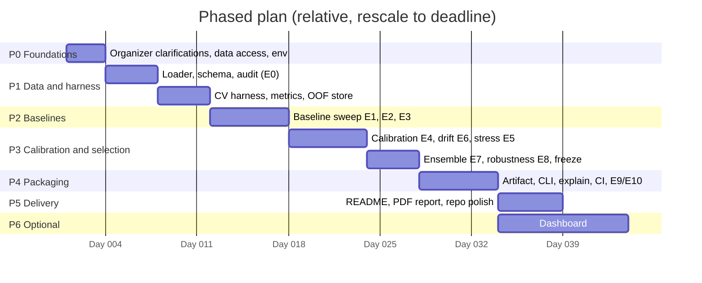

# IMPLEMENTATION_ROADMAP — Phased Development Milestones

The submission deadline is **unknown** (OD pending organizer info). Durations are relative effort estimates in working days for a small team and must be rescaled once the deadline is known. This roadmap begins **after** the documentation/research phase; no implementation is authorised yet.

---

## 1. Timeline overview

(Dates are placeholders for the Gantt renderer only.)

## 2. Phases, deliverables, gates

### P0 — Foundations (≈3 d)
- Obtain the CSV (the Drive folder was not retrievable during research — F8); record file hash.
- Send clarification list (below).
- Create repo skeleton, environment pinning, license choice, CI stub.
**Gate G0:** data readable; clarifications logged; A1–A4 first-look recorded.

### P1 — Data audit & harness (≈8 d)
- Loader + schema validator (FR-02), audit (FR-03, E0).
- Repeated-CV harness, metric functions (FR-07), OOF score store, seed management.
**Gate G1:** audit confirms/refutes assumptions A1–A3; metrics unit-tested; harness reproducible (two runs equal).

### P2 — Baselines (≈6 d)
- Implement B0–B8 behind one detector interface; run E1, E2, E3.
**Gate G2:** all baselines produce OOF scores; stability + preprocessing tables complete; OD-4 proposal.

### P3 — Calibration, stress tests, selection (≈10 d)
- E4 calibration, E6 drift, E5 synthetic stress tests, E7 ensemble, E8 contamination.
- Apply pre-registered selection rule (EXPERIMENT_PLAN §8); resolve OD-1, OD-2 (with organizer input), OD-3, OD-7.
**Gate G3:** config frozen and committed with rationale; deviations documented.

### P4 — Packaging (≈6 d)
- Final fit on 800 rows; artifact + manifest (FR-08); CLI (FR-09); explain (FR-10); portable `params.json`; E9 reproducibility, E10 timing; CI green.
**Gate G4:** fresh-clone smoke test passes; artifact round-trips; NFR checklist complete.

### P5 — Delivery (≈5 d)
- README (quick-start ≤ 5 commands), PDF report (measured/simulated/hypothesised box), model card, limitations.
- Independent read-through for citation integrity (every [K] verified or removed).
**Gate G5:** release checklist (SRS §9) fully ticked; tag `v1.0`.

### P6 — Optional dashboard (≈10 d, parallelisable after P4)
- Static dashboard reading exported JSON; implements FRONTEND_UI_UX_DESIGN. Must not delay P5.
**Gate G6:** accessibility audit, performance budget, reduced-motion path verified; shows no fabricated data.

## 3. Milestones summary
| Milestone | Phase | Evidence |
|-----------|-------|----------|
| M1 Data understood | P1 | Audit report |
| M2 Fair comparison harness | P1 | Reproducible OOF store |
| M3 Candidate ranking (benign-side + proxy) | P2–P3 | Tables with intervals |
| M4 Calibrated threshold | P3 | E4 result |
| M5 Frozen model artifact | P4 | Manifest + hash |
| M6 Submission-ready repo/report | P5 | Checklist |

## 4. Clarification list for organizers (P0)
1. Exact expected input/output format of the saved detector and predictions (A6). Is a `predict.py` entry point required?
2. Is validation prevalence known or approximate (A5)? Are validation traces from the same machine/protocol (A4)?
3. Are clean inputs fed to the backdoored model included in "backdoor runs" (A9)?
4. May participants generate their own backdoor traces for **validation only** (OD-6)?
5. Is redistributing the training CSV in the repo allowed?
6. Submission deadline, report length limit, license expectations.
7. Preferred label convention (1 = backdoor?) and whether scores are also read for AUROC.

## 5. Team roles (suggested)
Research lead (literature, experiment design) · ML engineer (detectors, harness) · Software engineer (packaging, CI, CLI) · Frontend engineer (optional dashboard) · Reviewer (citation integrity, reproducibility).

## 6. Definition of Done (per task)
Code + tests + docs + config committed; outputs regenerate from scripts; evidence-class tags present; requirement IDs referenced in commit/PR.

## 7. Contingencies
- Data late/unreadable → build harness against a clearly labelled synthetic benign-like generator for **testing code only** (never for reporting).
- Time short → drop P6, E8, ensemble; ship best single calibrated detector (B2 or B7 depending on E1–E4) with full honesty section.
- Audit shows near-constant/low-information columns → escalate R-01 handling in report.
