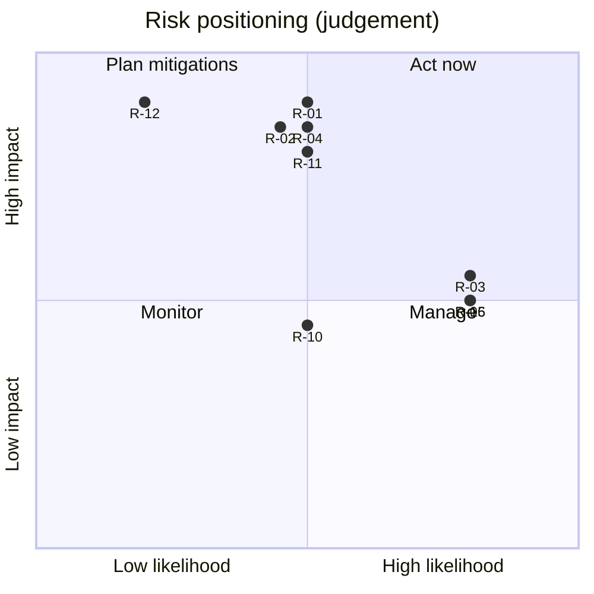

# RISK_ANALYSIS — Technical Risks, Limitations, Mitigations

Scale: Likelihood (L/M/H) × Impact (L/M/H). Ratings are **judgement-based estimates**, not measured. IDs referenced across docs.

---

## 1. Risk register
| ID | Risk | L | I | Early indicator | Mitigation | Residual |
|----|------|---|---|-----------------|-----------|----------|
| R-01 | **No usable signal**: backdoor traces are statistically indistinguishable from clean (A7 false); related stealthy-trojan work reports near-chance counter-based detection for a different attack **[V]** | M | H | E0 shows low-information columns; E5 not informative about this | Cannot be mitigated by modelling; ship robust, calibrated detector; state limit plainly; keep FPR controlled | High |
| R-02 | Training data unavailable/unreadable or schema differs from description (F8) | M | H | Loader errors at P0 | Early access check; ask organizers; schema-tolerant loader | Low |
| R-03 | **Threshold miscalibration** under unknown prevalence/validation shift → poor Accuracy/F1 though AUROC fine | H | M | E4 passes on benign but validation differs | Report α grid; ship justified default; keep scores for AUROC; clarify A5 | Medium |
| R-04 | **Distribution shift** between training and validation (different machine, session, background load, thermal state) — HPC pitfalls are documented [K SoK] | M | H | E6 drift evidence; narrow benign spread vs. large drift | Robust scaling, heavier tails tolerance, drift diagnostics, avoid over-tight thresholds, document | Medium-High |
| R-05 | Curse of dimensionality (d large vs n=800) → unstable covariance/kNN | M | M | Condition number, low stability in E3 | Shrinkage, PCA, feature pruning, kNN with moderate k | Low-Med |
| R-06 | **Proxy overfitting**: tuning to synthetic perturbations that do not resemble real backdoors | H | M | Gap between proxy ranking and stability ranking | Pre-registered rule; proxy as tie-breaker only; worst-case criterion; label proxies | Medium |
| R-07 | Benign training set contains outliers/contamination or mixed workloads | M | M | Heavy-tailed Mahalanobis distances in OOF | Robust (MCD) variants, trimmed fit, E8 | Low-Med |
| R-08 | One-sided assumption: backdoor lowers counters while method flags only increases | M | M | Directional asymmetry in scores | Two-sided scores (H4), signed explanations | Low |
| R-09 | Over-engineering with deep models on 800 rows | M | M | Complex model, unstable OOF | Default to shallow; justify any deep model with E-series evidence (H6) | Low |
| R-10 | Non-reproducibility (nondeterministic libs, version drift) | M | M | E9 mismatch | Pinned env, seeds, hashes, CI double-run | Low |
| R-11 | Interface mismatch with evaluator (A6) → submission not scored | M | H | No organizer reply | Ask early; provide CSV + Python API + simple CLI + portable params | Low-Med |
| R-12 | Citation errors/fabrication in report | L | H | [K] items unverified | Verify every [K]; cite only checked entries; reviewer pass | Low |
| R-13 | Pickle/serialization security or compatibility issues when judges load artifact | L | M | Version mismatch warnings | Manifest with versions; portable params; avoid custom classes in pickles | Low |
| R-14 | Adaptive attackers evade HPC-based detection | M | M (research context) | n/a | Document as limitation; no claims of adversarial robustness | Accepted |
| R-15 | Small-n variance in threshold at low α | H | M | Wide τ CI | α ≥ 0.01 only; bootstrap CI; CalibrationError guard | Medium |
| R-16 | Schedule overrun (unknown deadline) | M | M | Gates slipping | Contingency plan (roadmap §7), dashboard last | Low |
| R-17 | Dashboard misleads (e.g., decorative animation implies results) | L | M | Demo uses placeholder numbers | UI shows only exported real data; "no data" states; evidence-class badges | Low |
| R-18 | Counter multiplexing/overcount noise in provided data | M | L-M | Excess variance on some columns | Audit noise; robust transforms | Low |

## 2. Heat map (qualitative)

## 3. Limitations to state in the final report
1. **TPR cannot be measured on real backdoors** with benign-only data; reported power is synthetic and labelled.
2. Thresholds assume the benign distribution at deployment matches training (A3/A4).
3. The detector flags *deviation from benign HPC behaviour*, which can also arise from non-backdoor causes (system load, thermal throttling, different input mix) — false positives cannot be attributed to backdoors.
4. Detection feasibility depends on the backdoor perturbing HPCs (A7).
5. No claim of robustness to adaptive attackers.
6. Method evidence from general anomaly-detection benchmarks does not transfer automatically to HPC data.

## 4. Monitoring plan
Weekly risk review at phase gates; update likelihood after E0 (R-01, R-04, R-05), after E4 (R-03, R-15), after organizer replies (R-02, R-11).

## 5. Go / no-go triggers
- **E0 reveals unreadable/misaligned schema** → block P1 until resolved.
- **E3 stability below pre-set floor for all candidates** → simplify (fewer features, stronger shrinkage) before continuing.
- **E4 calibration fails for all** → investigate drift (E6) before shipping thresholds; ship scores + conservative α.
