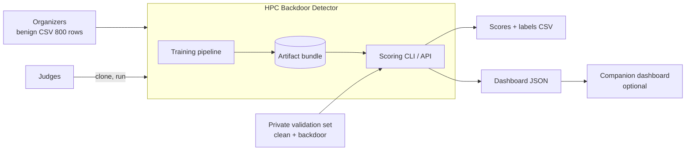
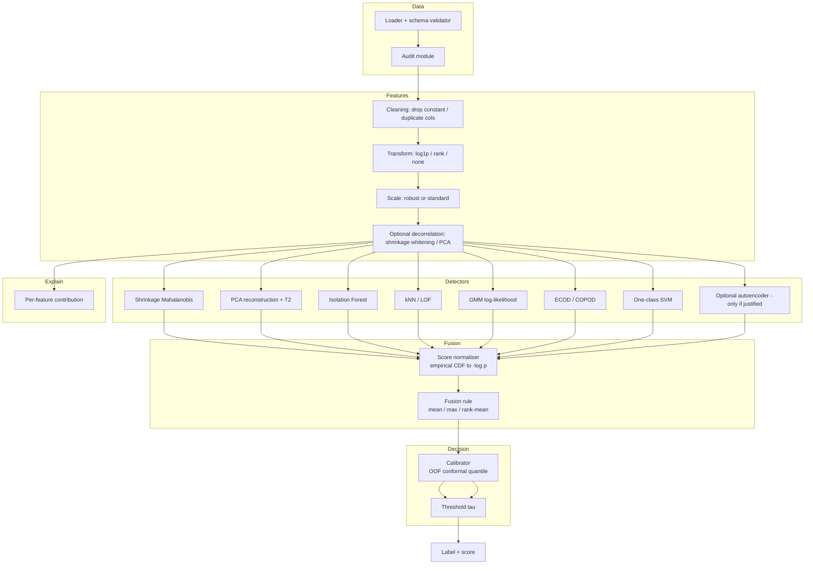
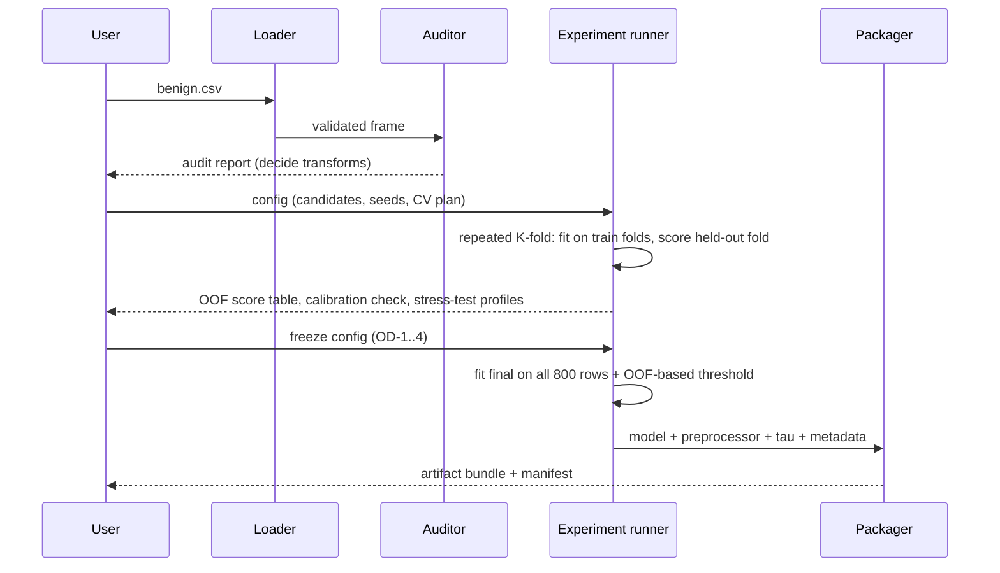
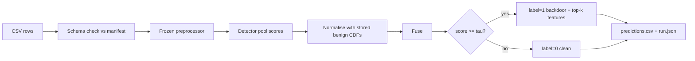
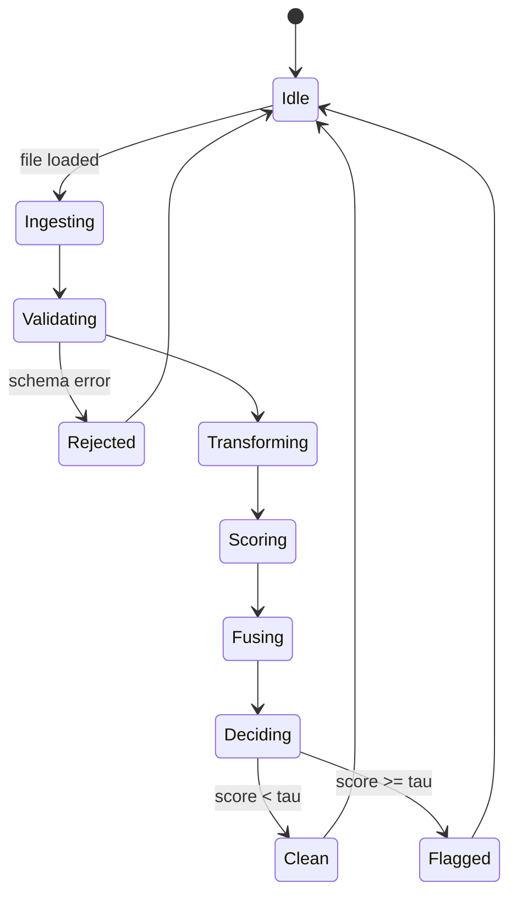

# SYSTEM_DESIGN — Architecture, Components, Data Flow, Detection Pipeline

IDs (F/A/H/OD/FR/NFR) are defined in TRD.md and SRS.md. Anything marked **candidate** is not a final decision.

---

## 1. Design principles
1. **One-class by construction** — no component accepts anomaly labels during fit.
2. **Small-data first** — low-capacity, regularised, resampling-validated components.
3. **Calibrate on what we can observe** — benign-side score distribution only.
4. **Separation of concerns** — data, features, detectors, fusion, calibration, serving, UI are independent modules with narrow interfaces.
5. **Evidence discipline** — every output tagged measured / synthetic-proxy / hypothesised.
6. **Reproducible by default** — config-driven, seeded, hashed.

## 2. Context diagram


## 3. Logical architecture

Which detectors participate in the final ensemble is **OD-1**; the diagram shows the candidate pool.

## 4. Component catalogue
| Component | Responsibility | Input → Output | Key requirement |
|-----------|---------------|----------------|-----------------|
| Loader/Validator | Parse CSV, check schema | file → DataFrame | FR-02 |
| Auditor | Distribution/correlation/drift diagnostics | DataFrame → audit JSON/MD | FR-03 |
| Preprocessor | Fit-on-train transforms | X → Z | FR-04 |
| Detector pool | Each exposes `fit(Z)`, `score(Z)` | Z → s | FR-05 |
| Normaliser | Put heterogeneous scores on common scale using benign OOF scores | s → u | FR-13 |
| Fusion | Combine u across detectors | u₁..u_k → s* | FR-13 |
| Calibrator | Derive τ at target α | OOF s* → τ | FR-06 |
| Explainer | Top-k deviating counters | Z, model → list | FR-10 |
| Experiment runner | Identical resampling for all candidates | config → tables | FR-11 |
| Stress-test generator | Synthetic perturbations (proxy) | benign rows → perturbed rows | FR-12 |
| Packager | Artifact + manifest | objects → bundle | FR-08 |
| Exporter | Dashboard JSON | outputs → JSON | FR-14 |

## 5. Training data flow (offline)


## 6. Inference data flow (online/batch)


## 7. Detection pipeline state model (also drives the UI visualization)


## 8. Artifact bundle
```
artifact/
  detector.joblib          # sklearn objects (candidate; OD-5)
  params.json              # portable parameters (means, precision, thresholds) - no code execution on load
  schema.json              # columns, dtypes, training quantiles
  threshold.json           # tau, alpha, calibration method, n_oof
  manifest.json            # versions, seed, config hash, data SHA-256, file hashes
  MODEL_CARD.md
```
Loading verifies hashes before deserialisation (NFR-05). The portable `params.json` path exists so the model can be reimplemented without pickle if organizers require it (OD-5).

## 9. Proposed repository layout (not yet created)
```
repo/
  README.md  LICENSE  pyproject.toml  Makefile
  configs/            # yaml: preprocess, detectors, cv, calibration, final
  data/               # empty; schema.json + checksum only
  src/hpcbd/
    io.py audit.py preprocess.py
    detectors/ (mahalanobis.py pca.py iforest.py knn.py gmm.py ecod.py ocsvm.py)
    ensemble.py calibrate.py explain.py stress.py metrics.py
    artifact.py cli.py
  experiments/        # runners producing tables/figures
  tests/
  reports/            # generated figures/tables; report source
  docs/               # this documentation package
  dashboard/          # optional
```

## 10. Cross-cutting concerns
- **Config**: YAML + dataclass validation; config hash stored in manifest.
- **Randomness**: single seed → child seeds per component; `PYTHONHASHSEED` fixed in CI.
- **Logging**: structured, no data values at INFO level.
- **Testing**: unit (metrics, calibrator), property (score invariance to row order), integration (fit→save→load→predict equality), regression (artifact hash).
- **CI**: lint → test → smoke `fit` on tiny synthetic benign-like data (no claims of realism) → build report.

## 11. Deployment view
Local CLI/Python import only. Dashboard (optional) is a static bundle served locally reading exported JSON; no backend required.

## 12. Architectural decisions deferred
OD-1 detector set · OD-3 fusion · OD-4 transform · OD-5 serialization · OD-7 order/drift use. Rationale: no data has been inspected; committing earlier would be premature.
